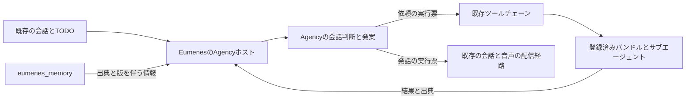

# Eumenes本流へのAgency統合実装計画

2026-11-06。**既存のAgencyホストを更新し、eumenes_memoryと既存ツールチェーンへ接続する。** Agencyの責務は会話、自動発話、調査や次の行動の発案までとし、実行はEumenesのバンドル・サブエージェントへ委譲する。新しいMemory、実行基盤、CIは作らない。

本書は実装計画であり、本流への取り込み・配布物の更新・DB移行は未実施。今回の変更は本書とREADMEへの導線だけとする。以降の実装順・受入条件は本書を使い、[出典契約の設計](host-input-provenance-2026-11-06.md)と[単体の品質検証](../docs/native-conversation-validation-2026-11-06.md)を引き継ぐ。過去の[統合スパイク](eumenes-integration-spike.md)にある新規ホスト作成や会話全体の初期化を、そのまま再実装しない。

## 目的と責務

利用者との会話とMemoryにある情報から、LLMが「話す・待つ・確かめる」を判断し、必要な依頼を既存の実行経路へ渡す。返ってきた結果を次の判断に使い、通常応答や既存の通知と重複せず会話へ戻す。



| 担当 | 保持するもの・判断すること |
| --- | --- |
| Agency | 自身の関心・意図・候補・判断・実行票。会話へ参加する価値、問いの意味、調査の必要性はLLMが判断する |
| EumenesのAgencyホスト | 全入力の出典対応、実行前後の現在性確認、保存と復元、取消・忘却の伝播、既存の会話・ツール・配信への接続 |
| eumenes_memoryと既存Memory domain | 利用者の情報、Records・State、アクセス検査、変更フィード、依存登録、忘却journalと削除確認 |
| 既存ツールチェーン | 能力の公開・版固定、バンドル起動、サブエージェント、ツール実行、予算・期限・進捗・結果の正本 |
| 既存の通常応答・通知・音声経路 | 明示的な依頼への返答、仕事の完了通知、発話・表示・再生。Agencyは同じ通知を作り直さない |

利用者自身の用事の催促、新しいTODO管理、独自のタスクスケジューラー、独自の検索・意味要約Memoryは範囲外。変更・不可逆操作が必要な発案は、既存の確認を伴う会話経路へ提案として渡す。自動で実行できる権限を増やさない。

## 調査した版と取り込み対象

対象Eumenesは `/Users/y.noguchi/Code/eumenes`、Agencyは本リポジトリ。両方に作業中の変更があるため、HEADだけで採用内容を識別しない。実装開始時に最新差分を取り直し、既存変更を保持する。

| 対象 | 現在の本流 | 採用・確認する対象 |
| --- | --- | --- |
| Eumenes HEAD | `0559873582e75c822ccc3d442e153e0f0a25711b` ＋作業中差分 | 実装時のHEAD・対象ファイルhash・既存差分を再固定 |
| Agency | 0.1.3、指示17、host-rules-14 | 0.1.5の評価済み修正を含む候補。指示29、host-rules-26 |
| Agency候補のHEAD | `03cde67996b0c7f9250760fec8a29fa70f38c5e5` ＋作業中差分 | 評価済みソースとの対応を確認し、新しいtgzとchecksumを作成 |
| Memory | 0.0.4、records/state/external契約1、lifecycle契約2、DB schema 8 | 本流の0.0.4を維持し、Agencyとの組合せを検証 |
| examplesで検証したMemory | 0.0.2、lifecycle契約1、DB schema 8 | 接続方法の参考。0.0.4への互換確認を省略せず、本流を降格させない |
| Zod / Bun | 本流Zod 4.4.3、Agency 4.6.7。両方Bun 1.4.4 | 配布物の型・schema変換・実行互換を確認。無関係な一括更新はしない |

本流の現Agency tgz SHA-256は `b4fc0e1e9ac15aaaee8f9c78b416e0dbd54a9f76f568d7d9f125769718cd3f7d`、Memory 0.0.4は `9c0e85aa2fa3106fc5ed939f465e8aa687158390b880a17e72adfe63a79fb8c9`。Memory側のソースは未コミット差分を含む配布物なので、manifestの`sourceHash`も識別に使う。

単体83.3点は、固定した合成48ケース・両provider・Memory 0.0.2・mockツールチェーンの評価で、信頼度Medium。本流の追加文脈、Memory 0.0.4、実バンドル、保存済み推論設定、実音声で同じ品質が出ることを保証する値ではない。評価プログラムhashは `98f927361db5fc4d77781b6406be156808a319803649dc448e0e77fcc319ee08`、ケースhashは `b74c6329ee9155c1ae9efc6328977943db0199f2f9b959f9aea4315ceb810cda`。

## 現在の接続と必要な変更

以下のパスはEumenesリポジトリを基準とする。まず既存の指示・公開操作・実行機構を更新・再利用し、専用の意味判定処理は追加しない。

| 接続 | 現状の根拠 | 必要な変更 |
| --- | --- | --- |
| Runtime | `api/application/agency/runtime.ts`はF、話題、TODO、関心形成、結果再利用を有効化済み | `conversationParticipation`を接続。archive・全入力の出典・復元を最新公開契約へ合わせる |
| 用途別の指示 | `agency/system-context.ts`と`api/domains/dialogue/contexts/agency/`が全文を構成 | 会話用の指示を用途ごとに整え、実際に有効な公開出力契約を埋め込む。本文と`InputContext`を同時に返す |
| 実際の推論入力 | `agency/llm-port.ts`が`dialogue.conversationTaskInTransaction`の会話prefix・Stateを後から追加 | prefixも含めて送信内容と出典を固定し、Agencyが検査する入力依存へ合成する |
| 観測・話題・TODO | `agency/feed.ts`は出典なしでobserve。`topics.ts`はDTOの版・元発話を落とし、`work.ts`はTODOを変換 | 観測IDから原記録・版・権限への対応を持つ。引用されなかった提示入力も追跡する |
| 保存 | `agency/checkpoint.ts`と`dialogue/repository/agency.ts`にsnapshot・cursor・epochの保存あり | provenance・archive参照・変更フィード位置・外部依存を同じ確定単位へ接続する |
| 忘却・撤回 | `server-services.ts`でMemory purgeを登録済み。`agency-state.ts`は参照の一致から会話単位で撤回。feedの撤回もruntime全体を作り直す | 最新の`prepareForgetting`等を使い、対象だけを失効。独立した仕事を残す。稼働中と遅延結果も遮断する |
| ツール委譲 | `agency/research.ts`→`dialogue/service/agency-state.ts`→`agents.startInTransaction`が存在 | 公開catalogの`revisionId`と実引数schemaを統一し、全入力依存・目的・受入条件を既存の実行契約へ引き継ぐ |
| 結果受付 | `agency/returns.ts`が`work.returned`とreceiptを保存。保存戻り値の確認が不足 | 失効検査と保存確定の後に受付を完了し、失敗を成功にしない。結果の出典を次の判断へ渡す |
| 発話 | `agency/delivery.ts`・`speech.ts`→会話appendまたはlive提案。epoch・generation・会話ordinal検査あり | 最新の依存・権限も再検査。通常応答を直近の配信へ反映し、採用・発話・再生の記録を分ける |

## 入力の出典契約

Agencyには既存の`InputContext { sources, complete }`と`WithInput<T>`を使う。Memory型やアクセス制御の実装をAgency coreへ持ち込まない。ホストは不透明な出典IDを次の情報へ解決できるようにする。

- 原記録の種類とID、版またはdigest、元のSourceKey・発話ID、派生の依存先。
- principal・scope・policyRevision、参照時の変更位置、有効期限、会話・設定・実行の世代。
- 原文を再読できる公開操作、忘却・訂正・停止時の無効化先。

これらをすべて`InputContext`へ詰め込むのではなく、ホストの対応表で管理する。実行票に付ける権限・世代の情報も、資料の引用IDとは区別する。

| 入力 | ホストで追跡する単位 |
| --- | --- |
| 固定の指示資産・出力契約 | 資産hash・契約版。追加の利用者情報を使っていない固定規則だけは`sources: [], complete: true`を宣言できる |
| 人格・関心・設定 | 設定の版と、そこに混ざる利用者情報の出典。設定に転記しただけでMemory依存を消さない |
| 会話の観測・訂正・通常応答 | 実際に提示した原発話のID・版・digestと採用状態。訂正の前後を同一の有効入力として扱わない |
| prefix・State・会話投影 | `conversationTaskInTransaction`が実際に表示した履歴、Memory、作業状態、投影の全出典。要約なら要約元も含む |
| Memoryの話題・再読 | 読み出したRecord/Stateの版・SourceRef・scope・アクセス条件。有効期限・推定/確定・否定等の判断資料も保持 |
| TODO・質問待ち | 既存work ledgerのID・版・質問・元依頼・関連資料。作業状態の正本は変えない |
| 能力一覧・引数契約 | 実際に提示した能力revision・schema hash・利用可否。非提示の全catalogへ依存を広げない |
| 委譲の問いと返却資料 | 問いを生成した全入力、実際に実行側へ渡した資料、返却元・版・状態・時点。`intent.evidence`だけを依存としない |

値とmetadataを同じ読取時点で確定し、同じ論理呼出し・通信再試行で使い回す。未申告の旧データを一律に`complete: true`へ変更しない。結果受付時に出典を追加して、元の不明な依存を修復したことにもしない。

**prefixの接続方針:** 既存の会話文脈構築を残し、公開portから本文と出典を一緒に取得する。Agency呼出し前にその組を固定し、用途別SystemContextの`WithInput`へ追加依存として合成する。LLM portはその同じ固定済み本文を使う。`llm-port.ts`で別時点の資料を読み足さない。Task用JSONはその呼出しの`request.prompt`を使い、外部資料をsystemの命令へ昇格させない。接続不能なら依存不明として停止し、検査を迂回しない。

## 実装順と完了条件

`P0 → P1 → P2 → P3 → P4 → P5 → P6 → P7`の順に進める。P4の指示整理はP2と設計を並行できるが、実モデル評価は保存・忘却・委譲・配信まで接続してから行う。

### P0 基準と変更範囲を固定する

1. 両リポジトリのHEAD、既存差分、対象ファイルhash、manifest・lockfile・実際に解決されるpackageを記録する。既存のrouter/pipeline等の作業と混ぜない。
2. Eumenesの`AGENTS.md`、現行のMemory仕様、ツールチェーン登録・検証手順、Agencyホストの設定・推論・保存契約を実装時の版で確認する。
3. 変更前の対象試験をローカルで実行し、既存の失敗と今回の差分を区別できるようにする。試験用の一時DB・journalを使い、本番DB・秘密・会話データを複製しない。
4. 検証台帳に、部分・結合・通し・実モデル・実機器の実施状況を分けて記録する。

**完了:** 再現可能な基準と対象一覧があり、無関係な作業を上書きせず進められる。

### P1 配布物とMemory 0.0.4の互換を確認する

1. Agencyの評価済み修正を含むソースから既存の`bun run pack`で新しいtgzを作る。HEADだけでなくdirty差分とソースhash、指示版・host-rules版・artifact hashを保存する。同じ版名の過去tgzと混同しない。
2. Eumenesの`vendor/agency/`、manifest、`package.json`、`bun.lock`、`api/application/vendor.test.ts`を更新対象にする。配布物は公開coreと型だけとし、examples・独自保存・APIキー・評価データを入れない。
3. 配布物の実consumerで`prepareForgetting`・`prepareCompaction`・最新Runtime設定と出典型の公開を確認する。本流Memory 0.0.4で、Record読出し・Stateの版・アクセス拒否・全ページ取得・変更フィード・外部依存登録・lifecycle 2の忘却/復元/削除確認をfixtureで確認する。
4. Zodの型とschema変換を両版が解決される実consumerで確認する。不一致があれば必要な接続だけを修正し、根拠なしにMemoryの版や検査を変えない。

**完了:** 新Agencyの公開型・実行と現行Memoryが実際に共存する。DB schema番号の一致だけで互換扱いしない。

### P2 全入力の出典と原観測の再読を接続する

主な変更先は`agency/host-types.ts`・`runtime.ts`・`system-context.ts`・`feed.ts`・`topics.ts`・`work.ts`・`llm-port.ts`・`assembly.ts`と、dialogue/Memoryの公開port。

1. 前節の入力棚卸しを実装し、各入力の本文と出典を一緒に固定する。`observe`・SystemContext・HostTopic・HostTodo・StandingInterest・ToolCapability・結果受付へ既存metadataを渡す。
2. `MemoryService`の既存DTO、`executionReferencesInTransaction`/`executionReferenceInTransaction`、ContextWindowのmanifest・shownMessageIds・policyRevisionを再利用する。足りない出典はその生成箇所の公開portから返す。applicationがMemory内部のSQLを直接読む形にしない。
3. Agency観測IDと、本流会話/Memoryの原記録・版・アクセスとの対応を持つ。原文は既存の原記録から読み、archive用の本文保管庫を新設しない。必要なRecords captureが未接続ならMemory domainの公開操作から接続する。
4. `ObservationArchive.get`は忘却・版・権限・scopeを確認してから返す。非表示・削除・失効した原文を、古いsnapshotから再読できないようにする。
5. 既存の保持上限と`prepareCompaction`を使い、IDと順序を保持して処理済み観測を退避する。失効確認を含む再読が成立したものだけを圧縮済みとする。
6. prefixを含む実送信messagesとmetadataの対応を試験する。非引用のMemory入力を忘却した場合も、その入力から生成した候補・結果を失効させる。

**完了:** ホスト独自指示・Memoryの話題・TODO・追加prefixを含む全入力が追跡できる。意味を語句・正規表現・固定辞書で分類する製品処理を増やさない。

### P3 保存とMemoryライフサイクルを接続する

主な変更先は`agency/checkpoint.ts`・`conversation-lifecycle.ts`・`feed.ts`・`recovery.ts`、`dialogue/service/agency-state.ts`・`repository/agency.ts`、Memoryの公開接続と`server-services.ts`。

1. 既存のsingle writerを使い、checkpoint、provenance、archiveへの対応、観測/Memoryの変更cursor、scope/epoch、必要な外部依存を整合する単位で保存する。別domainの表の操作は所有domainの公開操作へ委譲する。
2. Memoryの`registerExternalDependents`等をMemory側port経由で接続する。1依存物32参照・1呼出し256依存物等の公開上限は定数を参照する。全入力を捨てずに分割し、どの分割が忘却対象になっても同じ派生物を失効できるよう対応付ける。
3. 既存の`registerForgetPurge`とlifecycle 2 journal/hostIntentを使う。対象のcheckpoint・履歴・archive対応・投影・実行票・結果本文・配信待ちを消去/失効させ、実行中の推論と委譲を取消する。全対象の削除を確認してから外部削除確認を記録し、receiptの未確認を完了扱いしない。
4. メモリーAだけに依存する状態は`prepareForgetting`に従い削除し、Aと独立していることを完全な出典で確認できる仕事Bは継続させる。Aも提示した同じ推論の出力を「Bを引用したから独立」と扱わない。
5. 訂正・停止・期限切れ・権限変更も、変更フィードと読出し時/実行前後の確認で取り込む。旧版の票を失効させ、現在の資料をLLMへ渡して必要なら再発案する。変更の意味や代案をコードで決めない。
6. 保存失敗・purge失敗時はcursorや受付完了だけを先へ進めない。feedの一時障害は未処理として残す。永続的な不正イベントを処理済みにする場合は理由を保存し、欠落と区別する。DB rollback後は変異済みのメモリー上状態を捨て、確定状態から復元する。
7. 起動時はjournal照合と未完了削除を先に処理し、その後にAgency・キュー・配信を動かす。古いDBへの復元でも忘却が再適用されることを確認する。

Eumenesの忘却は、表示用の元会話を保持しつつ文脈・検索・派生物への再利用を遮断する契約を持つ。examplesの削除処理を丸写しして、製品の表示履歴を追加で削除しない。

**完了:** Aの忘却後、独立したBが結果受付・保存・再起動まで継続する。Aの遅延結果・旧archive・古いDBからの復活は0件。削除未確認時は完了を返さない。

### P4 会話と自動発話の指示を本流へ移す

1. `runtime.ts`でFの`conversationParticipation`を有効化し、その実設定から`agencyOutputContract`を生成する。候補なし発話には実際に提示した外部観測の参照を必要とし、tool・discardの候補必須条件や権限検査を保つ。
2. `contexts/agency/`のupdate/select等を、会話・自動発話・発案の目的に合う全文として構成する。古い長期計画用の指示と新しい会話用の指示を重ねて矛盾させない。人格・信頼境界・出力契約は共通資産を再利用する。
3. examplesの試験用人格・固定ID・「全資料へアクセスできる」というmock前提は移さない。実際に公開された能力・記録とアクセス範囲だけを資料として渡す。
4. 通常応答の採用内容を直近の`delivered`へ反映し、既に言ったことを重ねない。通常応答だけで自動発話の間隔をリセットせず、実際の`outboundWaitMs`を判断資料にする。
5. 自分の関心と利用者の意図、感想と外部の事実、昔の情報と現在の事実、発案と実行済みを指示で区別する。静かにしたい/断った等の意味判断もLLMが担い、個別の語句判定は追加しない。
6. 既存の通常応答の`conversationAgent.respond`/`runRespond`を維持する。新しい応答経路や完了通知経路を作らない。

**完了:** 通常会話、自動発話、候補なしの短い反応、質問待ち、結果を使う発案が有効な出力契約でつながり、通常応答と既存通知を重複させない。

### P5 発案を既存のバンドルとサブエージェントへ渡す

1. `research.ts`の`delegate`について、表示catalogを`revisionId`に統一し、実際のstrict引数schemaから公開JSON Schemaを作る。説明文を解析してschemaを復元しない。候補の数値revisionと能力の文字列revisionIdを区別する。
2. `agency-state.ts`の現在のWeb/履歴・非bindingの自動調査範囲を基準にする。`minImpact`の現行列挙は`none/create/modify_existing/irreversible`なので、旧`read`ラベル・未指定値との扱いを照合する。未指定だから安全と推定せず、実際の操作・承認要否から自動委譲可能な集合を公開する。意味による担当選択はLLMへ残す。
3. 受理直前に、現在の能力revision・公開状態・権限・世代・期限・予算・実行票を検証する。元の問い、理由、受入条件、許可された資料参照を`delegationRequest`と既存の委譲入力へ引き継ぐ。受入条件が問いの文章に含まれるだけの場合と、構造化して保存される場合を区別する。
4. `agents.startInTransaction`と既存のpackage解決・バンドル実行を再利用する。Agency専用バンドル・サブエージェント・リトライループは作らない。binding等の追加対応が必要なら既存の共通実行portで満たせるか先に確認し、今回の自動実行範囲を広げない。
5. `rootId`/ticket/epochで冪等に受け付け、開始済みの処理を再起動で二重投入しない。実行済みか不明なら既存の照会で確認し、確認不能な外部操作を自動で再送しない。
6. 返却時は全入力・権限・版・期限・取消・忘却を再検査する。`work.returned`とreceiptに出典を渡し、snapshot保存の戻り値まで確認してから返却済みにする。採用不可の本文を新しい観測へ入れない。
7. 返却資料を次の会話判断へ渡す。完了通知が既存経路で済む仕事は再通知せず、今の会話に役立つと判断した場合だけ内容を利用する。不足・失敗・中断・不明を全面成功へ変換しない。

**完了:** 実際の既存catalogから選んだ能力revisionで、`agency.idea → toolchain.accepted → bundle.started → subagent.started → subagent.returned → result.accepted → 会話判断`がつながる。結合試験ではモデル・外部I/Oをfixtureにできるが、ホストの実経路、バンドル起動、サブエージェント呼出しを省略しない。

### P6 配信と復旧を接続する

1. `delivery.ts`/`speech.ts`の既存writerと`live-bridge.ts`を再利用する。送出直前のgeneration・会話ordinal・現在の設定・foreground busyに、出典の有効性と権限の確認を加える。
2. 発話提案の受理、会話への採用、実際に発話した本文、ブラウザー再生を別の事実として記録する。`speechHandoff`は提案受理であり、再生成功にしない。切断・中断は実際に採用された範囲だけを次の重複判断へ反映する。
3. 既存の配信ID・音声側の提案IDとAgency ticketを対応付ける。単なる文章一致で取消対象を探さず、忘却・ユーザーの割込み・設定OFF時に該当する配信待ちと古い結果を遮断する。
4. 再起動時に、発話append済みなら既存メッセージを照合する。配信成否不明は`outcome_unknown`のまま扱い、自動で同じ発話を繰り返さない。
5. 音声の生成・保存・配信は既存backend、可聴再生は利用者が開いているEumenes Webだけで行う。backend/CLIから音を出さず、画面なし試験は消音する。
6. 診断は相関ID・版・理由コード・時間・件数・使用量に限定する。`diagnostics.ts`の自由文reasonも会話内容を含み得るため、通常ログへそのまま出さない。実入力の比較は合成fixtureの保護された検証成果物で行う。

**完了:** 二重発話・古い結果の配信・提案受理と再生の混同がなく、再起動・取消・忘却の競合でも整合する。

### P7 ローカル検証と段階的な有効化

1. 下記の部分→結合→通しの順に検証する。未接続の通し試験を繰り返さず、各段の失敗をその段の契約に絞る。
2. 実入力を固定して、通常会話・自動発話・発案の回帰を確認する。旧48件は既知の回帰で、新しいholdoutとは呼ばない。異なる語句・題材でも専用分岐なしに成立する対照例を追加する。
3. ローカル結合が通った段階を「本流ホストへの接続検証済み」とする。既存本番設定を自動でONにせず、検証用会話で実推論と既存の読取バンドルを別段階で確認する。
4. 実推論ではSQLite保存済み設定と実行時catalogを使う。API直呼び用のexamples設定や固定モデル名を本流コードへ移さない。既存の推論port・使用量記録を通し、推論先の実際の値・指示/schema/入力hash・flags・上限を結果に残す。取消・出力拒否・採用拒否でも、発生したAPI費用は精算する。使用量未取得の呼出しは予約を保持し、結果の非採用を費用0としない。
5. 実モデルの内容品質を測る場合は、既存の必要時成功80%以上・不要介入5%以下、必要/不要各24機会の基準を維持する。変更後の出力を採点し、旧出力の再生で新しい品質を証明しない。両系統を比較する場合は、利用可能な保存済み設定で同じ条件を作れることを先に確認する。
6. 音声は対象ブラウザー試験に続き、実機器の3往復を別記録にする。未実施なら音声MVPや本流の実利用品質を確認済みにしない。
7. README・本流の関連仕様・変更理由・配布物対応・残課題・切り戻し手順を更新する。差分に個別例の特例、意味判断の代替、担当外変更が増えていないかを最後に確認する。

**完了:** ローカル接続、実モデル品質、実機器受入を混同せず、実施した範囲と未確認条件が明確になっている。

## 必須の受入試験

| 段階・ID | 入力・競合 | 確認する結果 |
| --- | --- | --- |
| 部分 A1 | 独自SystemContext・話題・TODO・persona・能力を各々提示 | 本文と出典が対応し、metadataはモデル資料本文に漏れない |
| 部分 A2 | llm-portでprefix・Stateを追加、再試行中に元情報を変更 | 実送信の全資料を追跡。同じ試行の内容は固定。新しい世代の情報を旧出典で包まない |
| 部分 A3 | 同じIDの新版・別scope・権限取消・期限切れ・ページ境界 | 読める最新版だけを公開。全ページ処理と公開上限を守り、失効した値は実行前後で拒否 |
| 部分 A4 | `revisionId`の型違い・余分な引数・schema指定の混入 | strict契約で拒否。余分なキーの黙った除去や型の補正で成功にしない |
| 結合 B1 | F・本流の独自指示・Memory話題・TODOを提示してAを忘却 | A由来は失効。完全な出典で独立したBは結果受付・保存・再起動後も成功 |
| 結合 B2 | Aを入力に提示したが、モデルはBだけ引用 | 出力はAにも依存しており失効。引用の有無だけでBを独立としない |
| 結合 B3 | 忘却をLLM待ち、委譲中、結果直前、発話配信待ちに発生 | 取消・失効が各段へ届き、遅延結果から観測・候補・音声が復活しない |
| 結合 B4 | 訂正・停止・期限切れ・policy変更、処理中の世代交代 | 古い票を拒否。現在の資料を使ってLLMが再判断し、無関係な仕事を止めない |
| 結合 B5 | 32を超える依存、依存登録拒否、DB保存失敗、cursor保存失敗 | 欠落なく分割。失敗時に受付完了・cursorのみ進行・成功ログを残さない |
| 結合 B6 | journal先行後のDB rollback、旧DB復元、外部削除確認失敗 | 起動前に再適用。未確認を完了扱いせず、元会話の表示と再利用禁止を両立 |
| 結合 B7 | 旧版snapshot、出典不明、破損、設定OFF→ON | 不明を完全へ昇格させず隔離。元会話を保持し、新規の出典付き観測で再開 |
| 結合 B8 | 既存読取バンドルの正常・部分・失敗・中断・重複結果 | 実引数、バンドルとサブエージェントの呼出し、返却本文、保存、次の入力を照合 |
| 結合 B9 | 能力停止・revision交代・承認が必要な操作・実行済みか不明 | 実行直前も検査。不許可操作と不明な操作の再送を行わない |
| 通し C1 | 通常返答→会話の間→自動発話→発案→既存委譲→結果 | 既存の実経路で循環。通常返答・完了通知・自動発話の重複なし |
| 通し C2 | ユーザー割込み、foreground競合、再起動、配信成否不明 | 旧世代の結果は非採用。通常会話を妨げず、不明な発話を再送しない |
| 実モデル D1 | 本流で実際に構成した指示・prefix・Memory・能力 | 同じ内容評価基準で測定。fixture成功と区別し、採点不能・通信失敗を隠さない |
| 実機器 D2 | Eumenes Webで音声3往復・中断・切断 | 実際の発話/再生とreceiptを照合。画面外の再生なし |

会話品質の既知の失敗である「会話だけで十分な時の不要委譲」「調査すべき時の待機」「観測していないことの断定」「比較等を相手へ押し付ける反応」「不正なtool引数」も回帰に残す。未実装の複数記憶を組み合わせる意味的な攻撃のTODOは、未検証の安全範囲として保持し、成功に含めない。[単体結果の残課題](../docs/native-conversation-validation-2026-11-06.md)を参照し、期待値を弱めない。権限逸脱・忘却済み情報の復活・旧世代の結果採用など重大な安全違反が再現した場合は、有効化を止めて修正と回帰を先行する。

## ローカル検証の入口

以下は実装後に実施する候補。今回の計画作成では実行していない。CIの追加・実行は含めない。

Eumenesで、まず対象を絞った部分試験から始める。

```sh
bun test api/application/vendor.test.ts api/application/agency/schema.test.ts api/application/agency/system-context.test.ts api/application/agency/llm-port.test.ts api/application/agency/topics.test.ts api/application/agency/work.test.ts
```

接続が揃ったら、所有domainの保存・忘却とホストの結合を確認する。新規試験も同じ所有箇所へ追加する。

```sh
bun test api/domains/dialogue/test/agency-state.test.ts api/domains/memory/test/forget-contract.test.ts api/domains/memory/test/forget-closure.test.ts api/application/memory-package-integration.test.ts api/application/agency api/application/toolchain/toolchain-routing.test.ts api/application/media/live-voice.test.ts
```

最後に、変更した接続の所有・利用側domainを明示する。少なくとも下記を基本にし、capabilities・delivery・live・設定等を変更した場合はその利用側まで選択を広げる。

```sh
bun run verify -- --domain dialogue --domain memory --domain agent-runtime --domain tool-runtime --domain inference
```

`verify`の対象domain選択は、利用側までの試験をすべて自動選択する保証ではない。applicationの結合試験とブラウザー試験を別に明示する。`tests/browser/agency-todos.spec.ts`、`tests/browser/live-voice.spec.ts`等は実際に変更した導線だけを選び、Eumenesの既存Playwright設定に従う。サーバーの起動・停止・再起動が必要なら、その操作は実施前に利用者の明示許可を得る。現在の計画依頼にサーバー操作の許可は含めない。

Agency coreを追加修正した場合だけ、本リポジトリの部分試験から結合、`bun run verify`まで確認し、採用ソース・配布物を固定し直す。検証中の対象編集はその結果を無効にするため、編集と実行を分ける。

## 旧データの移行と切り戻し

| 対象 | 方針 |
| --- | --- |
| 旧snapshot | schema・指示/host-rules・設定・出典の互換を判定。完全な対応がある状態だけ移す。依存不明な派生状態は隔離/失効させ、元会話と利用者のMemoryは保持する |
| 新しい保存項目 | dialogueの所有migrationとrepositoryへ置く。本文の二重保管を避け、snapshot参照・provenance・source indexの世代を一致させる |
| 未完了の委譲 | rootId・票・epochで照会し、既存の実行を引き継ぐか取消。新しいruntimeへ無条件に結果を移さない |
| 未確定の発話 | 既存の配信記録を照合。不明なら自動再送せず不明のまま保持する |
| 有効化 | 既存のOFF設定を保持。検証用会話から開始し、通常応答への影響を確認してから利用範囲を広げる |
| 切り戻し | AgencyをOFFにし、旧コードが新形式を読まない状態へ戻す。必要なら派生状態を隔離した上で互換版へ戻す。単なる旧tgz差替えを復旧手順にしない |
| DB・journal | 忘却journal・失効世代・配信IDを巻き戻さない。古いDB復元時も最新journalを先に適用し、忘却済み情報や既送信の発話を復活させない |

## 費用と判断の区切り

今回の計画作成は有料API呼出し0。これまでのAPI累計は、未確定予約等を含む保守的上限 **9.15078549 USD（表示上9.16 USD）**、利用者の上限は累計10 USDのまま。既存予約を都合よく解除して残額を増やさない。

実装の部分・結合・ローカル通しは、合成資料とfixtureで追加API費用0を基本にする。本流のliveや有効化は保存済み推論設定から課金され得るため、既存の台帳と合算できる上限予約・精算を接続し、未知の単価・使用量も0とみなさない。残額約0.84921451 USDで十分と見積もらず、最大予約が累計10 USDを超える呼出しは開始しない。費用を制限できないliveは未実施として残し、追加予算が必要な場合だけ別途相談する。

| 判定 | 必要な証拠 |
| --- | --- |
| 実装済み | P1〜P6の接続、回帰試験コード、migration・停止/復旧手順が揃う |
| ローカル接続検証済み | A/B/Cの受入と選択domain検査が成功。失敗・skip・TODOを別記し、既存作業への影響がない |
| 本流の行動品質を検証済み | 本流の実送信入力と推論設定でD1を測定し、内容込み必要成功80%以上・不要介入5%以下等の基準を満たす |
| 音声まで受入済み | D2の実機器3往復を含む。単なる提案受理やfixtureの再生記録では代替しない |

単体完成度を再採点する場合も、技術50%・行動30%・忘却/圧縮20%、各領域75以上・合算80超の比率を維持する。今回の計画作成で83.3点を加点したり、本流品質へ読み替えたりしない。

同じ目的の試行3ラウンド、根拠のない同じ失敗の反復、検証中の編集、計画逸脱を認めた場合は、次の編集/再実行前に俯瞰する。増えた証拠・減った残作業・未解決仮説を確認し、継続・方針変更・停止の理由と次の一手を現在の会話へ短く報告する。正常に進捗する長時間処理を経過時間だけで再起動しない。

Memory起因と断定できる不具合が見つかった場合だけ、0.0.4配布物hash・公開APIによる単独再現・期待/実際・影響・受入試験をまとめ、Memory側への改修依頼として保存する。現時点では必須APIの不足を確認しておらず、Agency/ホストの接続不備を理由にMemoryの新API開発を先行させない。

## 参照する実装と規約

- Agencyの[出典契約](host-input-provenance-2026-11-06.md)、[Memoryライフサイクル](../docs/memory-lifecycle.md)、[mock委譲の結果](../docs/mock-toolchain-integration-2026-11-06.md)、[会話品質の結果](../docs/native-conversation-validation-2026-11-06.md)。
- Eumenesの[AGENTS.md](/Users/y.noguchi/Code/eumenes/AGENTS.md)、[ツールチェーン登録](/Users/y.noguchi/Code/eumenes/docs/toolchain-extension.md)、[検証手順](/Users/y.noguchi/Code/eumenes/docs/toolchain-extension-verification.md)。
- 現行ホストの[runtime](/Users/y.noguchi/Code/eumenes/api/application/agency/runtime.ts)、[LLM接続](/Users/y.noguchi/Code/eumenes/api/application/agency/llm-port.ts)、[保存](/Users/y.noguchi/Code/eumenes/api/application/agency/checkpoint.ts)、[委譲受付と忘却](/Users/y.noguchi/Code/eumenes/api/domains/dialogue/service/agency-state.ts)、[Memory公開service](/Users/y.noguchi/Code/eumenes/api/domains/memory/service/index.ts)。

調査後に本流の対象ファイルが変更された場合は、P0で差分を再確認してから実装する。計画外のMemory機構、権限拡張、担当選択の専用分岐、実行基盤への置換を追加する場合は、既存機構で満たせない具体的な根拠を先に示す。
